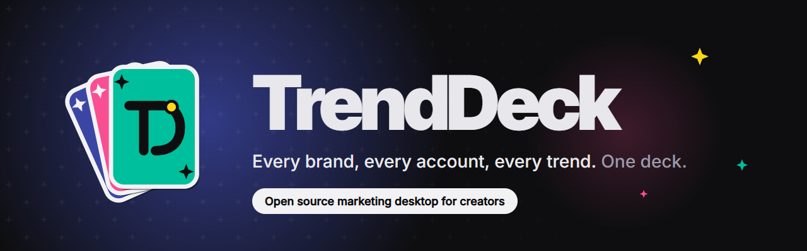

# TrendDeck

TrendDeck is a marketing desktop for creators. Every brand you run gets its own workspace: every account logged in at once, what's trending in your niche, and a chat pane that turns trends into posts.

Works with the AI subscriptions you already have: Claude Code, Codex, Cursor, Grok Build, OpenCode, Google Antigravity, Qwen Code and Kimi. If one is set up on your computer, TrendDeck can use it. Anything else plugs in too: any command line agent, or any OpenAI-compatible API (DeepSeek, GLM, OpenRouter, a local Ollama model).

## "So what's the catch?"

There isn't one. I built TrendDeck because I run more than one brand and got sick of logging in and out of the same five sites all day, then digging through ten tabs to figure out what to post next. The paid tools that do pieces of this are slow, cost a monthly fee each, and don't talk to each other.

I wanted one app that's fast on a cheap laptop, keeps everything on your machine, and is fully open. If it ever goes the wrong way, fork it and build the one you want.

## What it does

Working now:

- **Brands.** Your brands sit as small cards in the title bar. Each one has its own logins, niche keywords and recommendations, and switching is one click or Ctrl+1 to 9.
- **Every account at once.** Each brand gets its own browser session, so two brands can be logged into two different accounts on the same site and they never mix.
- **Site tabs.** Reddit, X, Instagram, TikTok, YouTube, YouTube Studio, vidIQ and 1of10 to start. Add any site with a name and a URL, drag to reorder.
- **Instant switching.** Sites you've opened stay loaded in the background, so going back to one doesn't reload it. Your first few sites load while the app sits idle. How many stay open per brand is up to you in Settings.
- **Trends.** One ranked feed of what's rising in your niche across Reddit, YouTube, Google Trends and TikTok, with today's top three up front.
- **Ideas board.** Save a trend as an idea in one click, or write your own down, then move it from idea to posted.
- **Schedule.** A month, week and list view of what goes out where and when.
- **Writer.** One idea written for YouTube, TikTok, Instagram, X and Reddit, with limits counted and versions saved.
- **Analytics.** Your followers and views read from your own logged in accounts when you press Refresh.
- **Media.** Every video, image and file you post, per brand. Drop them in or watch your exports folder, see what's been posted where, and pick which ones an agent may use.
- **Links stay in the app.** A trend, an idea or any link opens in that brand's tab for the site, or in a temporary tab if you don't have one. Never your normal browser.
- **Ad blocker.** On by default with the same filter lists as uBlock Origin, YouTube ads included. Turn it off per brand or allow a site in Settings.
- **Search.** One box in the title bar for trends, sites, brands and ideas. Paste a link to open it. Ctrl+K gets you there.
- **Quick on a cheap laptop.** The ad blocker loads after the window is up, sites you leave go quiet until you come back, and nothing heavy loads before you need it.
- **First run setup.** Name your brand and niche, pick your sites, done. Or skip it.
- **Settings.** One screen for the brand, its sites, the ad blocker, tabs and updates.
- **Local first.** Everything is saved on your computer. No account, no server.
- **Posting.** Write a post once and TrendDeck fills it in on YouTube, TikTok, Instagram, X or Reddit in your logged in session, then stops at Post so you can check it. It can press Post itself, run scheduled posts while the app is open, or go through the official APIs instead.

Brand colors, type and logo rules are in [docs/BRAND.md](docs/BRAND.md).

Coming next:

- **Chat**: ask your AI agent (any of the ones above, or your own) for ideas, outlines, titles and posts, with your brand and trends as context. Agents only ever run when you send a message.
- **Phone emulator** for app-only features

## Installation

> [!NOTE]
> The chat features need at least one agent installed and logged in:
>
> - Claude: install [Claude Code](https://claude.com/product/claude-code) and run `claude auth login`
> - Codex: install [Codex CLI](https://developers.openai.com/codex/cli) and run `codex login`
> - Cursor: install [Cursor CLI](https://cursor.com/cli) and run `agent login`
> - Grok Build: install [Grok Build CLI](https://x.ai/cli) and run `grok login`
> - OpenCode: install [OpenCode](https://opencode.ai) and run `opencode auth login`
> - Antigravity: install the [Antigravity CLI](https://antigravity.google) and sign in with Google
> - Qwen Code: install [Qwen Code](https://github.com/QwenLM/qwen-code) and run `qwen` to sign in
> - Kimi: install [Kimi CLI](https://github.com/MoonshotAI/kimi-cli) and run `kimi` to sign in
> - Anything else: add it in Settings > Agents, either a command to run or an OpenAI-compatible API URL and key
>
> Everything else works without one.

There's no installer yet, so for now you run it from source. You need [Node.js](https://nodejs.org) 22.12 or newer.

```bash
git clone https://github.com/JoshWright22/TrendDeck.git
cd TrendDeck
npm install
npm run dev
```

The first `npm install` also downloads Electron, so it takes a minute.

## Development

```bash
npm run dev        # app with hot reload
npm run build      # type check and build into out/
npm start          # run the build
```

To test without sound, add `--mute-audio` when you launch Electron or set `TRENDDECK_MUTE=1`. Every page, site and popup starts muted.

```
src/main       electron main process: window, json store, trends and the ad blocker
src/preload    the small api the ui is allowed to call, and the ad blocker's page preload
src/renderer   the react ui
src/shared     types used by both sides
resources      logo and app icons
```

## Where your data lives

Brands and sites are in `trenddeck.json` in the app's user data folder:

- Windows: `%APPDATA%\TrendDeck`
- macOS: `~/Library/Application Support/TrendDeck`
- Linux: `~/.config/TrendDeck`

Logins live in the same folder under `Partitions`, one folder per brand. Deleting a brand wipes its logins too. Cached trends are in `trends`, the ad blocker's lists are in `adblock`, and each brand's media library is in `media`.

Everything the app stores and every time it goes online is in [docs/PRIVACY.md](docs/PRIVACY.md).

## License

MIT, see [LICENSE](LICENSE).
